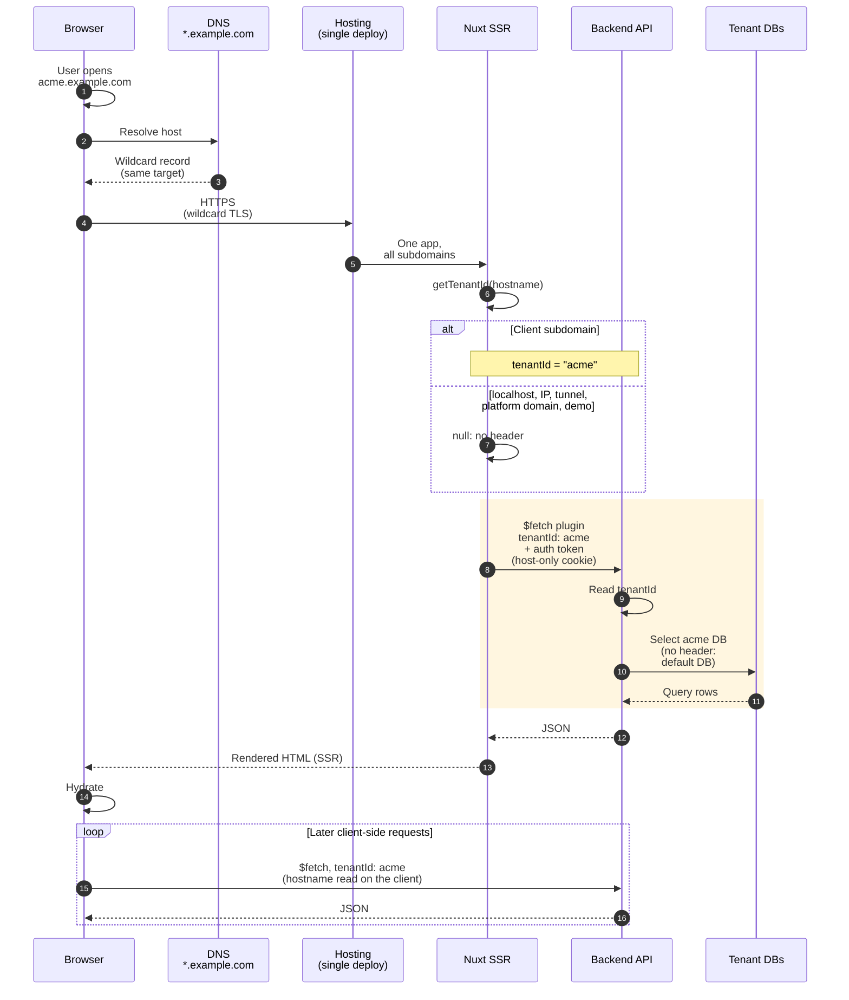
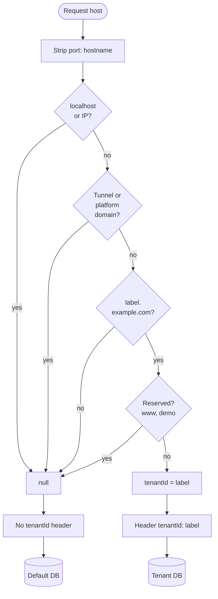

# Multi-Tenant — تعدد العملاء من الـ subdomain

**الحالة: مُنفَّذ وشغّال في الإنتاج (الموارد البشرية والمحاسبة) — نظام المخازن بيتنقل لنفس النمط دلوقتي**

## نظرة عامة

شركة برمجيات عندها كذا نظام أعمال (موارد بشرية، محاسبة، مخازن) بيخدموا جهات حكومية وخاصة. في النموذج القديم كل عميل كان ليه فرع git ونسخة deployment ومعاها backend app خاص بيه. القرار: **قاعدة كود واحدة وdeployment واحد لكل نظام**، والعميل (الـ tenant) بيتحدد من الـ subdomain اللي فاتح منه، والـ backend بيختار قاعدة بياناته من header واحد.

**المبادئ الحاكمة:**
- الـ subdomain هو هوية العميل — مفيش إعدادات لكل عميل في الـ build.
- الفرق بين عميل والتاني بيانات بس، مش كود.
- منطق تحديد واحد: نفس قواعد تحديد الـ tenant بتتطبق في كل طلب بيروح للـ API، من مكان واحد.

---

## المشكلة — فرع وموقع لكل عميل

الديمو كان هو فرع `main`. كل عميل جديد كان بياخد:
- فرع git خاص بيه (نفس كود `main` بالظبط).
- تطبيق Netlify خاص بيه (branch deploy)، بـ env vars لكل عميل زي الـ API URL والعنوان واللوجو.
- backend app خاص بيه على مزوّد الاستضافة.

في نظام الموارد البشرية لوحده كان فيه حوالي 50 فرع عميل، يعني حوالي 50 deployment منفصل. أي تعديل تطلبه جهة واحدة كان بيتبني ويتجرب على الديمو، وبعدين يتعمله merge وpush يدوي في كل فرع عميل. إصلاح لكل العملاء = حوالي 50 merge وpush يدوي، وNetlify بيعمل deploy لكل واحد فيهم أوتوماتيك.

**المشاكل:**
- نسخ العملاء كانت بتتأخر عن بعض وعن الديمو (drift).
- شغل يدوي متكرر في كل تعديل.
- مجموع الـ build minutes عدّى الـ free tier، فبقى تكلفة شهرية متكررة.
- backend app لكل عميل كان تكلفة إضافية هو كمان.

| المعيار | قبل — فرع لكل عميل | بعد — subdomain لكل عميل |
|---------|---------------------|---------------------------|
| الكود | فرع git لكل عميل (نسخة من `main`) | قاعدة كود واحدة |
| الـ frontend deployment | تطبيق Netlify لكل عميل (حوالي 50 في الموارد البشرية لوحدها) | deployment واحد لكل نظام على wildcard subdomain |
| الإعدادات | env vars لكل موقع (API URL، العنوان، اللوجو) | API base URL واحد للكل، والعميل بيتعرف من الـ subdomain |
| الـ backend | backend app لكل عميل | backend app واحد بيختار قاعدة البيانات من الـ header |
| إصلاح لكل العملاء | حوالي 50 merge وpush يدوي | deployment واحد |
| التكلفة | build minutes فوق الـ free tier + backend app لكل عميل | build minutes جوه الـ free tier + backend app واحد |

---

## القرار

درست المشكلة، واقترحت إن الـ tenant يتحدد من الـ subdomain. عرضت الفكرة في اجتماع، وحللنا كل نقطة فيها مع المدير، واتوافق عليها مباشرة.

صممت الطريقة وبنيت جانب الـ frontend. الـ backend (.NET، مسؤولية فريق الـ backend) بيحتفظ بقاعدة بيانات لكل tenant وبيختار القاعدة حسب الـ header.

---

## مسار الطلب

دورة حياة طلب واحد — من فتح الـ subdomain لحد ما البيانات تترسم في الصفحة. المصدر: [`diagrams/multi-tenant-sequence.mmd`](diagrams/multi-tenant-sequence.mmd) — الصورة: [فاتح](../public/diagrams/multi-tenant/request-sequence.light.svg) / [داكن](../public/diagrams/multi-tenant/request-sequence.dark.svg).



---

## تحديد الـ tenant — `getTenantId`

**الملف:** `utils/tenant.js`

قرار الدالة خطوة بخطوة. المصدر: [`diagrams/multi-tenant-tenant-resolution.mmd`](diagrams/multi-tenant-tenant-resolution.mmd) — الصورة: [فاتح](../public/diagrams/multi-tenant/tenant-resolution.light.svg) / [داكن](../public/diagrams/multi-tenant/tenant-resolution.dark.svg).



في نسخ Nuxt الحالية الـ hostname بييجي من `useRequestURL().hostname` — على السيرفر من الطلب نفسه (الـ host header)، وعلى الكلاينت من المتصفح. (النسخة القديمة الـ SPA كانت بتقراه من `window.location.hostname`.)

الدالة بتاخد أول label لما الـ host يطابق `<label>.<base-domain>`، وبترفض `www`. وبترجع `null` لـ `localhost`، وعناوين الـ IP، والـ dev tunnel hosts (زي ngrok)، والدومين الافتراضي لمنصة الاستضافة، والديمو.

```js
const BASE_DOMAIN = 'example.com'
const RESERVED = ['www', 'demo']

export const getTenantId = (hostname) => {
  if (!hostname || hostname === 'localhost') return null
  if (isIpAddress(hostname)) return null
  if (isTunnelHost(hostname) || isPlatformDefaultHost(hostname)) return null

  const suffix = '.' + BASE_DOMAIN
  if (!hostname.endsWith(suffix)) return null

  const label = hostname.slice(0, -suffix.length)
  if (label.includes('.') || RESERVED.includes(label)) return null

  return label
}
```

(مثال مبسّط للتوضيح، مش الكود الأصلي.)

| الـ host | النتيجة | ليه |
|----------|---------|-----|
| `acme.example.com` | `acme` | subdomain عميل — بيتبعت header |
| `www.example.com` | `null` | `www` مش عميل |
| `demo.example.com` | `null` | الديمو مستثنى — بيروح للقاعدة الافتراضية |
| `localhost` | `null` | تطوير محلي — القاعدة الافتراضية |
| `192.168.1.10` | `null` | عنوان IP مش subdomain عميل |
| dev tunnel host (زي ngrok) | `null` | مش subdomain عميل |
| الدومين الافتراضي لمنصة الاستضافة | `null` | شكله زي subdomain عميل، بس مش عميل |

---

## الـ Interceptor

لما القيمة `null`، مفيش header بيتبعت، والـ backend بيرجع للقاعدة الافتراضية.

الأمثلة دي مبسّطة للتوضيح، مش كود الإنتاج.

**Nuxt — `plugins/api.js` (SSR + client):**

```js
// composables/useTenantId.js
export const useTenantId = () => getTenantId(useRequestURL().hostname)

// plugins/api.js
export default defineNuxtPlugin(() => {
  const tenantId = useTenantId()

  const api = $fetch.create({
    baseURL: '/api',
    onRequest({ options }) {
      if (tenantId) options.headers.set('tenantId', tenantId)
    }
  })

  return { provide: { api } }
})
```

الـ plugin بيتنفذ مرة لكل request على السيرفر، ومرة واحدة في المتصفح — فنفس الـ tenant بيتحسب في الحالتين من غير أي كود خاص بكل بيئة. والطلبات اللي رايحة لسيرفر الهوية/تسجيل الدخول المنفصل مابتاخدش الـ header.

---

## إيه اللي بيختلف من عميل للتاني

البيانات بس. الكود واحد والـ build واحد. حتى الوضع (خاص/عام) مش إعداد للـ tenant — بيتحدد من رد الـ profile بعد تسجيل الدخول، والآلية دي متوثقة في [نظام الأوضاع](/adr/multi-mode-system).

---

## العزل

| الطبقة | الآلية | النتيجة |
|--------|--------|---------|
| قاعدة البيانات | قاعدة لكل tenant، والـ backend بيختارها من الـ header | بيانات كل عميل منفصلة |
| الـ session | auth cookie من نوع host-only — من غير ما نحدد cookie domain | كل subdomain ليه session مستقلة، والكوكي مابتتبعتش لأي subdomain تاني |

النتيجة إن session كل subdomain معزولة أوتوماتيك، من غير أي كود إضافي. (النسخة القديمة الـ SPA كانت بتخزن التوكن في `localStorage`، وده برضه مربوط بالـ origin، فالعزل كان متحقق هناك كمان.)

---

## البدائل

البديل الحقيقي الوحيد كان إننا نكمّل على النموذج الحالي. مفيش معماريات تانية اتقارنت رسمياً — الفكرة اتعرضت، واتحللت نقطة نقطة، واتوافق عليها.

| البديل | المشكلة |
|--------|---------|
| نكمّل على فرع + موقع + backend app لكل عميل | الـ drift والـ merges اليدوية بيزيدوا مع كل عميل جديد، والتكلفة بتكبر معاهم |

---

## ما تغيّر أثناء البناء

| التغيير | البداية | اللي ظهر | التعديل |
|---------|---------|----------|---------|
| اسم الـ header | `tenant_id` | بعض الـ proxies بتشيل الـ headers اللي فيها underscore (nginx بيعمل كده افتراضياً) | الاسم بقى `tenantId` — مايعتمدش على إعداد proxy معين |
| الديمو | الديمو subdomain زي أي عميل، فكان بيبعت header | الديمو مش عميل — هو النسخة اللي بتتجرب عليها التعديلات | الديمو اتستثنى ومابيبعتش header |
| التطوير المحلي | `localhost` وعناوين الـ IP مالهاش subdomain عميل | محتاجين التطوير المحلي يشتغل من غير tenant | الدالة بترجع `null`، فالتطوير المحلي بيكلّم القاعدة الافتراضية |
| الـ dev tunnel hosts | host زي ngrok كان بيتقري كأنه tenant | تسجيل الدخول نجح، بس الـ profile رجع فاضي | الـ tunnel hosts اتستثنت |
| الدومين الافتراضي لمنصة الاستضافة | الدومين الافتراضي اللي منصة الاستضافة بتديه للموقع (من الشكل `site-name.platform-domain`) ماكانش مستثنى | شكله زي subdomain عميل بالظبط، فأي deploy لسه على الدومين ده أول جزء منه بيتقري كأنه tenant | الدومينات الافتراضية للمنصة اتستثنت زي الـ tunnel hosts |

---

## النتائج والحالة

- أي إصلاح بيوصل لكل العملاء في deployment واحد.
- مفيش merges لكل عميل، ومفيش drift.
- الـ build minutes رجعت جوه الـ free tier.
- backend app واحد بدل واحد لكل عميل.
- إضافة عميل جديد بقت subdomain + قاعدة بيانات، مش فرع وموقع جديد.

| النظام | الحالة |
|--------|--------|
| الموارد البشرية | اتنقل وشغّال في الإنتاج، ونسخة Nuxt الجديدة مبنية بنفس النمط |
| المحاسبة | اتنقل وشغّال في الإنتاج |
| المخازن | بيتنقل لنفس النمط دلوقتي |

---

## الملفات ذات الصلة

تقسيم مقترح للأمثلة اللي فوق — مش هيكل الملفات الفعلي في الشركة.

| الملف | الوصف |
|-------|-------|
| `utils/tenant.js` | `getTenantId` |
| `composables/useTenantId.js` | بيقرا الـ hostname على السيرفر والكلاينت ويطبّق `getTenantId` |
| `plugins/api.js` | الـ interceptor اللي بيضيف الـ header |
